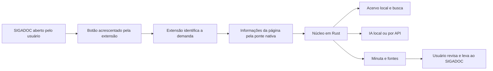

# Botão do assistente dentro do SIGADOC

Data: 2026-11-01. Evolução do conceito a partir da proposta do usuário de um botão injetado no SIGADOC. O usuário definiu a ação: importar as informações da página para a aplicação em Rust. A proposta foi submetida a uma [rodada de seis revisores Goldfish](goldfish_botao_report.md); a solução ainda não foi implementada nem testada na instalação.

## Direção proposta

Adicionar uma extensão ao navegador que apresente um botão do assistente na página do SIGADOC. O botão será o ponto de entrada da demanda no acervo e nas funções de análise em Rust. A extensão acrescenta a interface no navegador do usuário; não requer, por esse mecanismo, alterar o código hospedado no servidor do SIGADOC.

O nome proposto passa a ser **Importar para o assistente**. O clique capturará as informações reconhecidas na página atual e as encaminhará à aplicação Rust para armazenamento, busca e análise. A página do SIGADOC será o ponto de captura; a organização do acervo e a elaboração das respostas ocorrerão no aplicativo local. A importação mostrará o que foi gravado e o que permanece pendente.

O papel do aplicativo permanece: reunir documentos e fontes, classificar assunto e prioridade, recuperar semelhantes, preparar minutas e registrar o resultado conhecido. Assinatura e tramitação continuam pelo usuário no SIGADOC.

## Caminho técnico proposto

A extensão terá uma pequena camada JavaScript/TypeScript para trabalhar com a página; o armazenamento, a análise, a IA e as regras continuarão no núcleo Rust. A recomendação passa a ser apresentar o acervo e o editor no aplicativo local, com a extensão responsável pela importação. Tauri continua como candidato para essa interface; o núcleo e o acervo não dependem dessa escolha específica. Um painel no navegador deixa de ser necessário à primeira versão.

O Chrome permite que um script de extensão leia e altere a estrutura da página e se comunique com a extensão. Para o botão aparecer automaticamente, a atuação deverá ser declarada para as páginas específicas do SIGADOC, com o acesso correspondente habilitado no navegador. [Documentação: content scripts](https://developer.chrome.com/docs/extensions/develop/concepts/content-scripts).

Uma alternativa é ativar a extensão pela barra do navegador usando acesso temporário à aba. Isso implica um gesto anterior no controle da extensão e não equivale a um botão que já aparece sozinho na página. [Documentação: activeTab](https://developer.chrome.com/docs/extensions/develop/concepts/activeTab).

Para ligar navegador e Rust, a recomendação inicial é Native Messaging: a extensão se comunica com um executável local registrado pelo instalador e limitado ao identificador da extensão. A comunicação passa pela extensão e seu processo em segundo plano; o script da página não acessa diretamente o executável. O protocolo tem limites por mensagem; o primeiro incremento levará identificação, metadados, texto e referências. O mecanismo de arquivos será escolhido após a prova de aquisição, comparando recursos existentes antes de propor transporte próprio em partes. Essa solução evita tornar uma porta HTTP local uma dependência inicial, mas acrescenta instalação e teste da ponte. [Documentação: Native Messaging](https://developer.chrome.com/docs/extensions/develop/concepts/native-messaging).

Essas capacidades do navegador sustentam a proposta de interface; não demonstram compatibilidade com as telas e os fluxos do SIGADOC real. Chrome é a referência da pesquisa, ainda sem confirmação do navegador usado pelo usuário.

## Como o documento chegaria ao acervo

### Importação das informações da página

A primeira captura proposta atenderá à página de detalhe de um documento ou processo aberto. Uma tela com lista de documentos ou mesa virtual exigirá um modo próprio de seleção/importação; não será interpretada como se fosse um único documento.

| Grupo | Informações a capturar, quando exibidas e reconhecidas |
| --- | --- |
| Identificação e origem | Número e identificador do documento/processo, título, endereço da página e momento da captura. |
| Metadados | Tipo documental, assunto ou descrição, remetente/unidade, destinatário, datas e situação apresentada. |
| Conteúdo | Texto efetivamente disponível na página, com identificação da seção de origem; campos de senha e controles sem relação com a demanda ficam fora da captura. |
| Histórico visível | Movimentações e relações apresentadas na tela, sem presumir que representam todo o histórico. |
| Recursos vinculados | Referências e links de originais, anexos e antecedentes encontrados. Um link será registrado como referência, não como arquivo já adquirido. |

O pacote de importação levará dados estruturados e texto de origem. Na aplicação Rust, informações extraídas, dados confirmados pelo usuário e inferências posteriores da IA ficarão separados. Prazos mencionados no texto serão conservados com seu contexto, sem se tornarem datas confirmadas apenas por terem sido capturados.

O aplicativo identificará se a demanda já existe e registrará nova captura ou atualização sem apagar notas, correções ou minutas. O usuário verá uma confirmação como **informações da página importadas**, acompanhada das quantidades e pendências conhecidas. Erro de comunicação ou falha de gravação não deve aparecer como sucesso.

### Aquisição de arquivos e complementação

Ao clicar, a extensão deve identificar com segurança o processo ou documento atual, seu link e os metadados disponíveis. A identidade deve acompanhar a operação mesmo que o usuário troque de aba ou abra outro documento. Antes de associar a uma demanda existente, o núcleo verificará os identificadores e a origem conhecidos.

A prova de integração avaliará a obtenção de originais, dossiê, anexos e movimentações pelos recursos disponíveis à sessão do usuário. Capturar texto visível não basta para afirmar que o documento original ou todos os anexos foram baixados. A arquitetura não prevê repassar senha ou cookies de sessão ao núcleo Rust ou ao provedor de IA.

Requisições feitas pelo script da página e pela extensão têm condições distintas de origem e permissões. Será necessário testar os downloads autenticados e eventuais proteções de formulário, sem presumir que um link encontrado possa ser lido de qualquer contexto. Uma permissão da extensão não amplia os direitos do usuário no SIGADOC. [Documentação: requisições de extensões](https://developer.chrome.com/docs/extensions/develop/concepts/network-requests).

Se houver mudança de layout, documento não reconhecido, sessão expirada ou aquisição incompleta, o aplicativo mostrará a etapa que falhou e conservará o material já obtido. Uma captura por clique cobre a demanda selecionada; baixar toda a mesa do usuário e acompanhar alterações são capacidades adicionais, a validar separadamente.

## Preparo e retorno da minuta

Importar ou atualizar uma captura enviará o estado reconhecido atual da página, vinculando-o à demanda já existente quando a identidade for confirmada. Abrir a demanda no acervo será uma ação distinta; não se presumirá que a fonte não mudou sem nova captura ou sinal confiável. A classificação e a redação usarão o histórico local previsto no planejamento original.

Para o retorno, a primeira proposta é preparar o texto e oferecer uma ação explícita de transferência para o campo correto ou um pacote de arquivo aceito pelo SIGADOC. Preenchimento assistido só será incluído após identificar e testar o editor da instalação; não deve ocorrer automaticamente ao abrir um documento ou ao gerar nova redação. A versão transferida precisa ficar registrada e a revisão do usuário continua necessária. O botão não assinará nem tramitará.

Não haverá declaração de conclusão oficial baseada apenas no preenchimento da tela. O aplicativo deverá recuperar ou vincular o documento oficial posteriormente, distinguindo a informação confirmada pelo sistema da informação registrada pelo usuário.

## Alternativas e consequência para o plano

| Alternativa | Utilidade | Limitação para este conceito |
| --- | --- | --- |
| Extensão com botão e núcleo local Rust | Mantém a entrada do trabalho no SIGADOC e conecta ao acervo local | Exige extensão, ponte instalada e manutenção do reconhecimento das páginas. É a direção proposta pelo usuário e passa a ser a hipótese principal de interface. |
| Script de usuário ou favorito com código | Pode demonstrar o posicionamento do botão com pouco esforço | Não entrega sozinho a ponte nativa e o acervo Rust. Não foi escolhido como arquitetura permanente nesta proposta. |
| API do SIGADOC com aplicativo local | Pode obter dados estruturados e atualizar o acervo | Sua disponibilidade continua desconhecida; pode coexistir com o botão, caso comprovada. |
| Importação e exportação manual | Preserva uma saída quando a captura ou o retorno não funcionar | Continua como alternativa, não como interface principal proposta. |
| Alteração oficial do SIGADOC | Permite integração incorporada ao sistema de origem | É uma via distinta, que depende da equipe mantenedora e não é presumida necessária para a extensão local. |

## Nova prova de conceito

Primeiro demonstrar em uma demanda o percurso: reconhecer a página de detalhe, apresentar um único botão, capturar identificação/metadados/texto disponíveis, transferir as informações ao Rust, persistir o vínculo e reabrir o mesmo registro sem duplicação. Demonstrar também indisponibilidade da ponte, falha de gravação e falha de reconhecimento sem misturar documentos. Nenhum conteúdo real deve ser enviado à IA apenas por abrir a página.

Em seguida, provar a aquisição do original e dos anexos acessíveis, a complementação do histórico e a colocação de uma minuta no editor, conservando a assinatura e a tramitação nas ações do usuário. O objetivo completo de manter documentos locais continua preservado; a importação da página é a primeira entrega verificável dessa integração. A hipótese original está em `review_input.md`; a evolução do botão foi congelada em `review_input_botao.md` e examinada no relatório da nova rodada.

## Recomendações da revisão para o desenho técnico

Definir contrato versionado da ponte e recusar versões incompatíveis antes de alterar o acervo. Cada tentativa deve ter identificação própria e confirmação somente após a persistência; repetição após perda da confirmação precisa recuperar o resultado sem duplicação indevida. Novas capturas devem manter origem, momento, cobertura e versão do reconhecedor, separadas de notas e minutas do usuário.

Antes de distribuir mudanças incompatíveis, definir migração e recuperação do acervo. Separar a confirmação da importação da análise por IA; o destino local ou por API e a abrangência do conteúdo processado devem permanecer visíveis. Essas recomendações são entradas para egm-draft, não provas executadas ou decisões de arquitetura já aprovadas.
