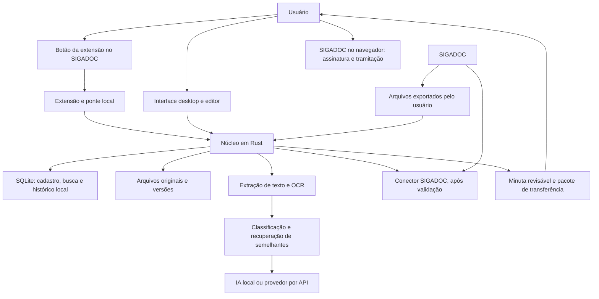

# Opções técnicas para o assistente SIGADOC

Data: 2026-11-01. Estas são recomendações para o planejamento, não decisões aprovadas nem uma implementação testada. As seis lentes Goldfish examinam a hipótese em `review_input.md`; estas notas são pesquisa complementar da consolidação.

**Evolução do conceito:** o usuário definiu um botão injetado no SIGADOC para importar as informações da página para a aplicação Rust. A [proposta de extensão e ponte Rust](botao_sigadoc.md) detalha essa entrada do trabalho. O acervo e o editor serão apresentados na aplicação local; Tauri continua como candidato de interface, ainda sem decisão aprovada.

## Arquitetura sugerida

Um núcleo em Rust com armazenamento local, conectado ao botão de importação na página do SIGADOC por uma extensão de navegador e uma ponte instalada. A primeira entrega verificável importa os dados reconhecidos da página para a aplicação local; aquisição de originais, anexos e histórico será validada em seguida. Não se propõe servidor próprio ou banco em nuvem no início. Windows é a plataforma inicial sugerida pelo ambiente atual, ainda não confirmada como requisito pelo usuário.

O conector será inicialmente de leitura. A colocação de minutas no SIGADOC terá implementação própria apenas se o fluxo admitido pela instalação for comprovado. O caminho por arquivos atende ao trabalho local, mas não equivale à sincronização automática pretendida.

## Componentes candidatos

| Componente | Proposta | Motivo e limite |
| --- | --- | --- |
| Entrada no SIGADOC | Extensão com pequeno script JavaScript/TypeScript e ponte nativa para Rust | Acrescenta o botão na página do usuário. A captura e o retorno serão testados na instalação; detalhes em botao_sigadoc.md. |
| Interface da aplicação local | Tauri 2, com interface HTML/CSS/TypeScript e lógica em Rust | Candidato para o acervo e o editor locais. Esta opção não é inteiramente escrita em Rust; a escolha específica ainda não foi aprovada. |
| Banco e busca textual | SQLite, `rusqlite` e FTS5 | Guarda registros e permite busca por palavras sem serviço externo. Busca por significado será uma camada adicional, não uma capacidade atribuída ao FTS5. |
| Rede | `reqwest` com Tokio no núcleo Rust | Um adaptador para SIGADOC e adaptadores separados para provedores de IA. Ter cliente HTTP não comprova que exista uma API do SIGADOC acessível. |
| PDF e texto | `pdfium-render` como candidato para extração e visualização | Depende da biblioteca nativa Pdfium; sua distribuição deverá ser validada no instalador. |
| PDF digitalizado | Tesseract com dados de português, acionado pelo núcleo | OCR reconhece texto de imagens; o resultado é derivado e pode conter erros. Não altera o original. |
| IA local | Modelo local servido pelo Ollama e consumido via HTTP | A aplicação permanece em Rust; o motor de modelos é uma dependência separada. Selecionar modelo e memória após medir a máquina. |
| IA remota | Adaptador HTTPS para o provedor escolhido | Validar separadamente geração, classificação e embeddings. Não presumir equivalência de contratos entre provedores. |
| Segredos | Cofre do sistema operacional, com `keyring` como candidato | Evita gravar tokens e senhas no acervo ou nos logs. |

As versões e licenças de distribuição serão fixadas na especificação e verificadas em uma instalação limpa. Não se propõe escrever motores próprios de PDF, OCR ou modelos de linguagem.

Fontes primárias: [Tauri](https://v2.tauri.app/start/), [capacidades e permissões do Tauri](https://v2.tauri.app/security/capabilities/), [rusqlite](https://docs.rs/rusqlite/latest/rusqlite/), [SQLite FTS5](https://www.sqlite.org/fts5.html), [reqwest](https://docs.rs/reqwest/latest/reqwest/), [pdfium-render](https://docs.rs/crate/pdfium-render/latest), [Tesseract: idiomas](https://tesseract-ocr.github.io/tessdoc/Data-Files), [Ollama: API](https://docs.ollama.com/api/introduction), [keyring](https://docs.rs/keyring/latest/keyring/v1/index.html).

## Fluxo de análise e aprendizagem de máquina

1. Preservar os bytes originais, calcular seu hash e registrar origem, data de aquisição e vínculo oficial conhecido. Extrair texto por página; executar OCR somente onde necessário. Arquivos ilegíveis, protegidos ou de formato não atendido continuam no acervo, com indicação de que seu conteúdo não foi analisado.
2. Criar trechos com referência ao documento, versão e página. A tela deve permitir abrir a fonte de uma sugestão, inclusive quando o número da página no PDF for diferente da numeração impressa.
3. Usar um modelo já treinado para sugerir um ou mais assuntos de uma lista editável. A primeira lista será construída com uma amostra do trabalho do usuário. Marcadores locais de assunto não substituirão a classificação arquivística oficial do SIGADOC.
4. Extrair alegações de prazo com trecho de origem. Data expressa, contagem relativa, prazo confirmado e estimativa permanecem distintos. Não calcular prazo relativo sem marco inicial e regra de contagem conhecidos; encaminhar ambiguidades para conferência.
5. Ordenar por prazo confirmado e regras explícitas; usar o conteúdo para sugerir urgência com justificativa. Um documento sem prazo identificado deve aparecer como pendente de conferência, nunca como automaticamente pouco importante. Correções do usuário prevalecem sobre a sugestão e ficam registradas.
6. Combinar busca por palavras com comparação de vetores de significado para recuperar semelhantes. Antecedentes documentados e semelhantes encontrados por IA terão rótulos diferentes. Cada resultado mostrará a fonte e permitirá avaliar a utilidade; semelhança não demonstra que o mesmo encaminhamento serve ao caso atual.
7. Construir a minuta com um modelo textual, fatos e fontes selecionados pelo usuário. A IA auxiliará na redação; informações ausentes serão marcadas para preenchimento. Textos documentais serão tratados como dados, sem poder ordenar ações ou alterar as instruções do aplicativo.
8. Guardar as correções como exemplos rotulados. Só treinar ou ajustar um classificador próprio quando houver dados e ganho demonstrado sobre o modelo inicial. Separar treino e avaliação por processo, evitando que versões do mesmo caso apareçam nos dois conjuntos. Atualizar modelo não deve apagar rótulos humanos.

O modo local e o modo remoto terão seleção persistente por tarefa. Se um serviço local falhar, o aplicativo não trocará silenciosamente para um provedor externo. A falta de IA não impedirá abrir originais, buscar por palavras ou editar uma minuta manualmente.

## Registros locais necessários

| Registro | Conteúdo essencial |
| --- | --- |
| Origem e escopo | Instalação, identidade e unidade consultadas, meio de aquisição e abrangência conhecida. |
| Documento e versão | Identificador oficial, número exibido, espécie, data, origem, link, situação observada, hash e última observação. A granularidade entre processo, documento e via depende da validação do SIGADOC. |
| Arquivos e relações | Originais, anexos, ordem conhecida, vínculo ao processo e relações informadas ou sugeridas. |
| Prazo e prioridade | Alegação de prazo, fonte, marco inicial quando conhecido, confirmação, motivo da urgência e alterações humanas. |
| Resultado de IA | Tarefa, provedor, modelo e versão conhecidos, configuração, entradas identificadas por versão, resultado e correção. Não armazenar raciocínio privado de modelos. |
| Minuta e modelo | Conteúdo editável, modelo usado, revisões, fontes selecionadas e versão exportada. |
| Retorno oficial | Identificador do documento resultante, versão oficial obtida, vínculo com a minuta e se o retorno foi confirmado por leitura do SIGADOC ou informado pelo usuário. |
| Execução | Última tentativa e último sucesso de cada etapa, pendências, erros e retomadas. |

Cada importação será repetível sem criar duplicatas indevidas. Novas versões não substituirão silenciosamente a versão analisada. Quando surgirem documentos posteriores à minuta, o aplicativo indicará a necessidade de reavaliar o contexto.

O banco ativo deverá ficar em armazenamento local da aplicação, separado da pasta de código no Google Drive. Propor cópias de segurança consistentes do banco, um manifesto dos arquivos e conferência de hashes ao restaurar; não usar a simples cópia de um banco aberto como estratégia de backup. [SQLite: backup](https://www.sqlite.org/backup.html).

## Editor e modelos iniciais

O editor terá fontes e anexos ao lado, salvamento automático de rascunhos, histórico e indicação da versão preparada. A ação de transferência deve mostrar exatamente qual versão e quais anexos foram preparados. Exportação realizada não significa assinatura ou tramitação concluída.

Três modelos iniciais, para personalizar com documentos aprovados pelo usuário:

**Resposta a ofício:** referência ao ofício e processo; síntese da solicitação; fatos examinados com fontes; resposta organizada por ponto; documentos que acompanham a resposta; fecho.

**Encaminhamento:** referência e unidade destinatária; síntese da demanda; motivo do encaminhamento; providência solicitada; prazo somente quando informado ou confirmado; relação dos documentos que seguem.

**Solicitação de complementação:** referência; informação ou documento ausente; motivo da necessidade; relação objetiva do que deve ser apresentado; prazo indicado pelo usuário, se houver; fecho.

Na primeira versão, oferecer texto formatado para transferência e um arquivo de conferência. A escolha de PDF, DOCX ou rascunho nativo para entrada no SIGADOC depende do teste da instalação. Não chamar um PDF exportado de minuta editável no SIGADOC sem comprovar esse fluxo.

## Piloto, custos e critérios de aceitação sugeridos

Começar com um lote proposto de 100 demandas representativas, incluindo processos com muitos anexos, documentos digitalizados, casos sem prazo, prazos conflitantes e respostas já concluídas. O tamanho é uma proposta de piloto, não informação sobre o acervo do usuário ou garantia estatística.

- Comparar a organização por assunto com rótulos revisados pelo usuário, incluindo taxa de correção e resultados por assunto.
- Medir prazos expressos recuperados, prazos críticos omitidos e ambiguidades sinalizadas. A meta funcional é não esconder omissões: conferir prazos no piloto permanece parte da análise.
- Medir utilidade dos cinco primeiros semelhantes, cobertura dos anexos e precisão dos vínculos entre fonte e trecho.
- Comparar o tempo entre abrir uma demanda e obter uma minuta utilizável com o fluxo atual; medir a parcela do texto que exige correção factual.
- Demonstrar reimportação sem duplicação, retomada após interrupção, preservação de minuta após atualização e restauração completa do backup.
- Validar em homologação ou fluxo admitido que uma versão preparada chega ao local correto no SIGADOC; assinatura e tramitação ficam fora da automação.

Antes do piloto, registrar máquina, memória, volume e tamanho dos arquivos e orçamento escolhido pelo usuário. Definir limites de lote, tamanho, concorrência, tempo e tentativas. Começar com um trabalho pesado de cada vez e aumentar apenas após medição, sem bloquear a interface.

O gasto de IA remota será estimado pelo total de tokens de entrada, saída e embeddings multiplicado pelas tarifas do provedor; preços e orçamento não foram escolhidos. Mostrar consumo por tarefa, evitar reanalisar versões sem mudança, limitar tentativas e pausar ao atingir o teto configurado. A IA local requer espaço para modelos e memória, a medir; não prometer execução rápida sem GPU ou infraestrutura gratuita.

## Etapas propostas

| Etapa | Entrega | Condição para avançar |
| --- | --- | --- |
| 0. Botão e prova de integração | Importação de identificação, metadados e texto da página para a aplicação Rust, persistência e reabertura; depois provar originais, anexos, histórico e transferência | Demonstrar o percurso na instalação e navegador usados; distinguir dados, links e arquivos obtidos. Captura de uma demanda e sincronização da mesa são capacidades distintas. |
| 1. Acervo e consulta | Importação, originais, relações, texto/OCR, busca, visualização, histórico e backup | Reimportar e restaurar sem perder vínculos ou minutas; exibir conteúdo não processado. |
| 2. Triagem assistida | Assuntos, prazos, prioridade e semelhantes com fontes | Avaliar com casos reais e correções humanas; ajustar critérios de conteúdo e limites. |
| 3. Redação e retorno | Modelos, editor, revisões, pacote de transferência e vinculação do resultado oficial | Testar o percurso completo mantendo assinatura e tramitação no SIGADOC pelo usuário. |
| 4. Piloto e distribuição | Instalador, dependências verificadas, métricas e diagnóstico local | Validar qualidade, uso de memória, custos, backup e experiência na máquina escolhida. |

Não estimar uma data de entrega firme antes da etapa 0 e da medição do acervo. Trata-se de planejamento de conceito, ainda não de especificação pronta para implementar.
